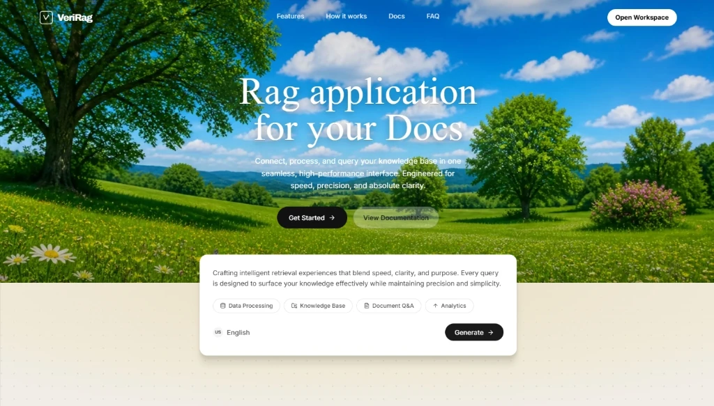
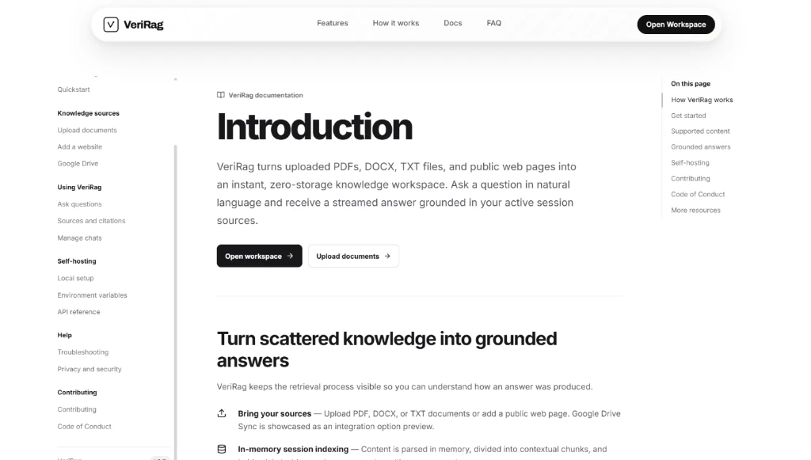
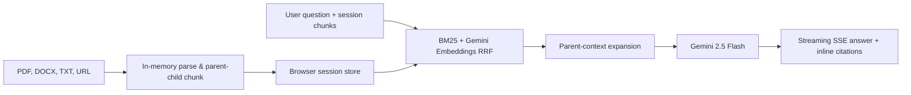

<div align="center">

# VeriRag

**Ask naturally. Verify every answer.**

A stateless, zero-storage Retrieval-Augmented Generation workspace that turns uploaded PDFs, DOCX, TXT files, and public web pages into cited, streaming answers—ready for 100% free Vercel deployment.

[](LICENSE.md)
[](https://www.python.org/)
[](https://react.dev/)

[Documentation](#documentation) · [Quickstart](#quickstart) · [Deploy on Vercel](docs/DEPLOYMENT.md) · [Contributing](CONTRIBUTING.md)

</div>



## What VeriRag does

VeriRag lets anyone upload PDFs, DOCX, TXT files, or public website URLs and ask grounded questions immediately—with **no login wall, no database, and zero server-side file storage**. Documents are parsed in memory, chunked for your active browser session, searched via hybrid BM25 + Google Gemini embeddings (`gemini-embedding-001`) with Reciprocal Rank Fusion (RRF), and answered via streaming Server-Sent Events with clickable `[1]` source citations.

- **Zero-account, zero-storage design** — No sign-in or sign-out barriers; uploaded PDFs are never saved on the server
- **Multiple knowledge sources** — PDF, DOCX, TXT, public HTTP/HTTPS URLs, plus Google Drive Sync showcased as an integration option preview in Data Center
- **Hybrid grounded retrieval** — Sparse BM25 lexical search + Google Gemini dense embeddings fused with RRF and parent-context expansion
- **Streaming interface** — Real-time token streaming over SSE with live retrieval progress and interactive `[1]` source inspection
- **100% Free Vercel Deployment** — Lightweight serverless FastAPI (`api/index.py`) + static React build (`frontend/dist`) in a single repository

## Product preview



## How it works



## Stack

- **Frontend:** React 18, Vite, React Router, Motion, GSAP
- **Backend API:** Stateless FastAPI (`backend/main.py`, `api/index.py`)
- **Retrieval:** `rank-bm25`, NumPy, `gemini-embedding-001`, Reciprocal Rank Fusion (RRF), parent-context expansion
- **Generation:** Google Gemini (`gemini-2.5-flash` via `langchain-google-genai`, optional AgentRouter support)
- **Hosting:** Vercel Hobby (free tier) using `vercel.json` + `api/index.py` + `frontend/dist`

## Quickstart

### Requirements

- Python 3.13
- Node.js 22 and npm
- A Google AI Studio API key (`GOOGLE_API_KEY`)

### 1. Clone and configure environment

```bash
git clone https://github.com/sainishanth-m/VERIRAG.git
cd VERIRAG
cp .env.example .env
```

Set your Google Gemini key in `.env`:

```env
LLM_PROVIDER=google
GOOGLE_API_KEY=your_google_gemini_api_key
GOOGLE_LLM_MODEL=gemini-2.5-flash
```

### 2. Install dependencies

```bash
pip install -r requirements.txt
npm --prefix frontend ci
```

### 3. Run the application

In terminal one:

```bash
python -m uvicorn backend.main:app --host 127.0.0.1 --port 8000 --reload
```

In terminal two:

```bash
npm --prefix frontend run dev
```

Open [http://localhost:5173](http://localhost:5173). API docs are available at [http://localhost:8000/docs](http://localhost:8000/docs).

## Deploy Free on Vercel

See [Vercel deployment guide](docs/DEPLOYMENT.md). In short: import the repository on Vercel, set `GOOGLE_API_KEY` (and `LLM_PROVIDER=google`) in Project Environment Variables, and deploy—`vercel.json` builds `frontend/dist` and routes `/api/*` to `api/index.py`.

## API

FastAPI publishes interactive OpenAPI docs at `/api/docs` (when serving `frontend/dist`) or `/docs`:

- `GET /api/health` and `GET /api/health/ready`
- `POST /api/ingest/files` — parses PDF/DOCX/TXT uploads in memory and returns session chunks
- `POST /api/ingest/url` — fetches and chunks one public HTTP/HTTPS URL in memory
- `POST /api/query` — stateless hybrid retrieval + answer with citations
- `POST /api/query/stream` — stateless SSE streaming (`meta`, `token`, `done`, `error`)
- `POST /api/feedback` — accepts session feedback

## Quality checks

```bash
pytest -q
npm --prefix frontend test
npm --prefix frontend run build
```

## Repository layout

```text
api/                     Vercel Python serverless entrypoint (api/index.py)
backend/                 Stateless FastAPI routes and SSE streaming
frontend/                React + Vite workspace and sessionStorage/localStorage state
src/                     In-memory parsers, chunker, Gemini embeddings, BM25 + RRF search
evaluation/              RAGAS evaluation script and sample dataset
docs/                    Deployment guide and screenshots
```

## Documentation

The app includes a built-in documentation page at `/docs`. Repository documentation includes:

- [Vercel deployment guide](docs/DEPLOYMENT.md)
- [Contributing](CONTRIBUTING.md)
- [Security policy](SECURITY.md)
- [Code of Conduct](CODE_OF_CONDUCT.md)

## License and Attribution

VeriRag is customized for academic demonstration and evaluation from an open-source Apache License 2.0 codebase. All original copyright notices and license terms are preserved in [LICENSE.md](LICENSE.md).
