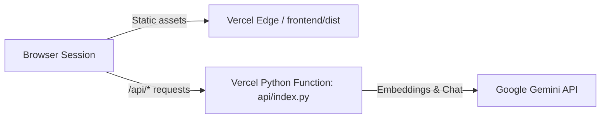

# Deploy VeriRag for Free on Vercel

VeriRag is architected to deploy cleanly as a single project on **Vercel's free Hobby tier**—with zero databases, zero external Docker hosts, and zero paid subscriptions.

## Architecture on Vercel



- **Frontend (`frontend/dist`)**: Built by Vite (`cd frontend && npm ci && npm run build`) and served statically from Vercel's CDN with SPA rewrites.
- **Backend (`/api/*`)**: Stateless FastAPI serverless function (`api/index.py` importing `backend/main.py`). Lightweight dependencies in root `requirements.txt` keep the Python bundle well under Vercel's serverless limit.
- **Privacy & Storage**: Uploaded PDFs, DOCX, TXT files, and URLs are parsed strictly in memory during the upload call and stored only inside the visitor's browser session (`sessionStorage` + in-memory store). Chat threads live in `localStorage`.

---

## Option 1: Push to GitHub & Deploy via Vercel Dashboard

1. Initialize and push from the project root folder (the folder containing `vercel.json`, `api/`, `backend/`, `frontend/`, and `src/` — `.env`, `node_modules/`, `frontend/dist/`, and `uv.lock` are already excluded in `.gitignore`):
   ```powershell
   cd c:\Users\HP\Downloads\verirag\verirag
   git init -b main
   git add .
   git status   # verify .env and uv.lock are NOT listed
   git commit -m "feat: deploy stateless VeriRag for Vercel"
   git remote add origin https://github.com/sainishanth-m/VERIRAG.git
   git push -u origin main
   ```
2. Go to [vercel.com/new](https://vercel.com/new) and import **`sainishanth-m/VERIRAG`**.
3. Keep the root directory as `./` (do **not** change Root Directory to `frontend/`, because root [`vercel.json`](../vercel.json) builds `frontend` and serves `api/index.py` together).
4. Add **Environment Variables** in Vercel Project Settings:
   - `LLM_PROVIDER` = `google`
   - `GOOGLE_API_KEY` = `your_google_gemini_api_key`
   - `GOOGLE_LLM_MODEL` = `gemini-2.5-flash`
5. Click **Deploy**.

---

## Option 2: Deploy directly from CLI

```bash
npm install -g vercel
vercel login
vercel env add GOOGLE_API_KEY production
vercel env add LLM_PROVIDER production
vercel --prod
```

When prompted by `vercel`, accept the detected settings from `vercel.json`.

---

## Verify Live Deployment

Once Vercel prints your `https://<project>.vercel.app` URL:

1. Open `https://<project>.vercel.app/api/health/ready` — confirm it returns `{"status":"ready","checks":{"stateless_engine":true,"llm_configured":true}}`.
2. Open `https://<project>.vercel.app/chat` — upload a PDF, DOCX, TXT, or URL and ask a question to verify streaming answers and `[1]` citations.
3. Visit `https://<project>.vercel.app/chat/data` — confirm Google Drive Sync renders as an option preview and uploaded files remain ephemeral to your browser session.
